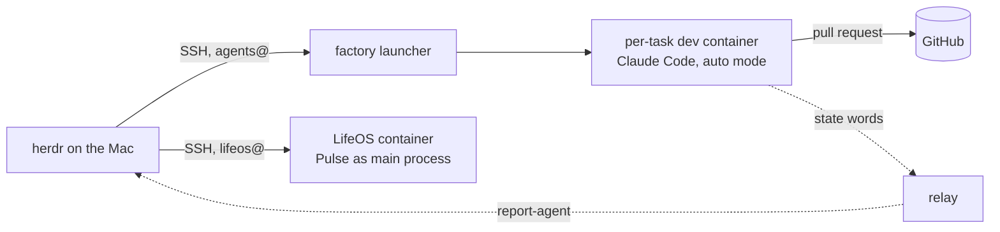

# factory

What runs on the agent factory, homelab VM 270 (NixOS, `nix/nixos/factory.nix`):
coding agents that each take one GitHub issue in a throwaway container and end
with a pull request, and LifeOS, a personal assistant in one long-lived
container. Both are driven from the Mac with herdr.

The VM sits on an untrusted VLAN that reaches the internet and nothing else in
the lab, and holds no lab credential. Two Unix users keep the two uses apart,
each with its own rootless Podman: `agents` runs unreviewed code, `lifeos`
holds personal data.



NixOS ships this directory to `/etc/factory` (the VM never clones the
dotfiles), and installs the two commands with `writeShellApplication`, which
runs shellcheck at build time.

## Files

| Path | What it is |
|------|------------|
| `bin/factory` | The launcher: `factory <owner/repo> <issue> [--force] [--sans-permissions]`, `factory list`, `factory clean` |
| `devcontainer.json` | The dev container every task uses, passed with `--config` |
| `image/Containerfile` | Task image `localhost/factory-agent`: gh, .NET SDK, Claude Code pinned, Matt Pocock's skills, global rules |
| `image/settings.json` | Claude settings baked into it: herdr state hooks, no attribution, concise style |
| `image/claude-task` | Starts Claude with the task's credentials, read from a read-only mount |
| `lifeos/Containerfile` | LifeOS image `localhost/lifeos`: bun, Claude Code, gh, rg, python3 |
| `lifeos/lifeos-pulse` | The LifeOS container's main process: Pulse in the foreground |
| `lifeos/lifeos-launch` | Opens LifeOS with its system prompt |
| `lifeos/lifeos` | The host command: `lifeos`, `lifeos claude`, `lifeos shell`, `lifeos status`, `lifeos logs` |

## How a task runs

1. The launcher reads the issue with that repository's PAT and refuses it
   without the `agent-ready` or `ready-for-agent` label (`--force` skips the
   check).
2. It clones the repository, gives the task its own secrets directory (the
   Claude token and that one repository's PAT, nothing else), and starts the
   dev container.
3. It relays the container's state hooks to herdr for the current pane: the
   container never gets the herdr socket, which drives every pane.
4. Claude runs `/mattpocock-skills:implement` on the issue in auto mode, then
   opens the PR. The branch name and conventions are the repository's own.
5. On exit the container goes, the clone stays until `factory clean`.

## Maintenance

```sh
# Apply a change to this directory or to factory.nix
nix run nixpkgs#nixos-rebuild -- switch --flake ~/dotfiles/nix#factory \
  --target-host root@10.10.70.10 --build-host root@10.10.70.10

# Rebuild the task image (bump CLAUDE_CODE_VERSION in image/Containerfile)
ssh agents@10.10.70.10 'podman build -t localhost/factory-agent:latest /etc/factory/image'

# Rebuild LifeOS's image, then restart it (its data lives in the lifeos-home volume)
ssh lifeos@10.10.70.10 'podman build -t localhost/lifeos:latest /etc/factory/lifeos && systemctl --user restart lifeos'
```

Secrets live on the VM only, never here: `~agents/.config/factory/secrets/`
(the Claude token, `gh/<owner>__<repo>` PATs) and `~lifeos/.config/lifeos/secrets/`.
